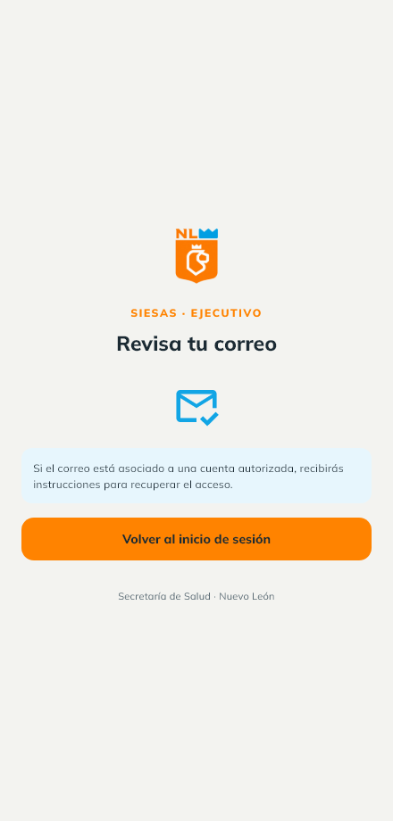
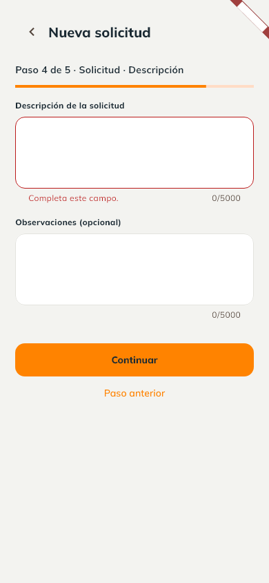
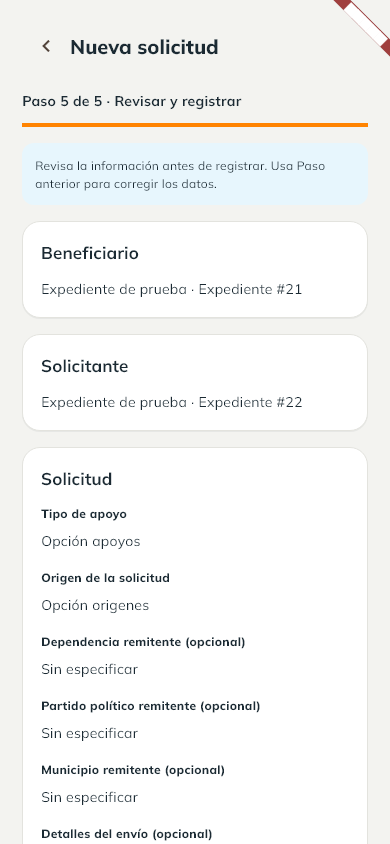
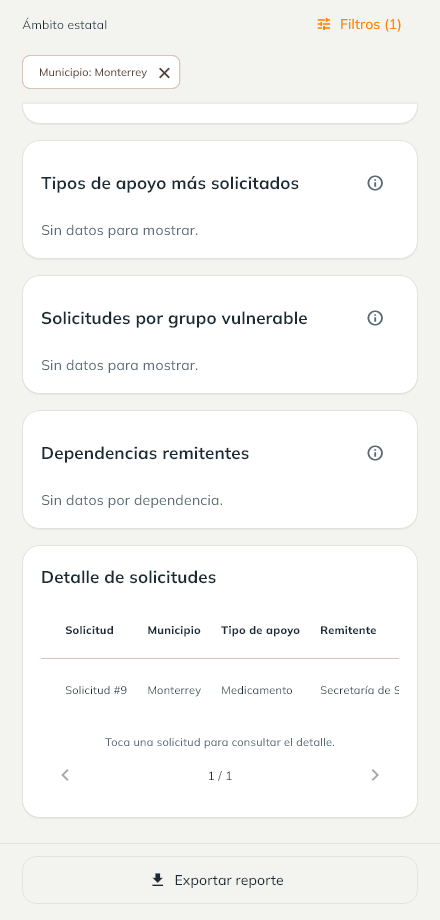
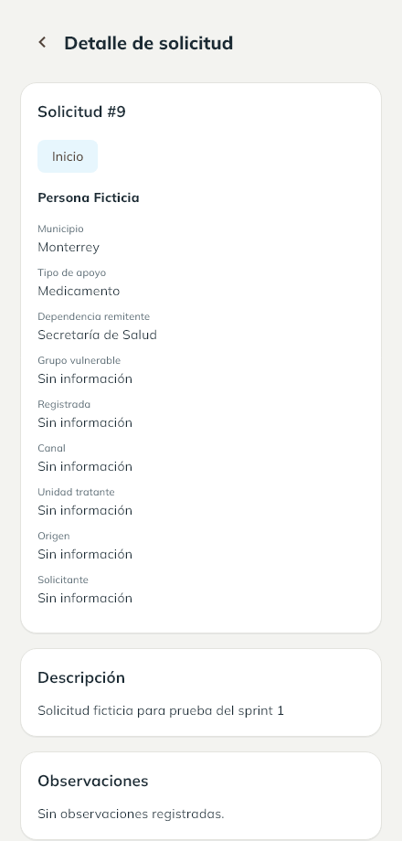
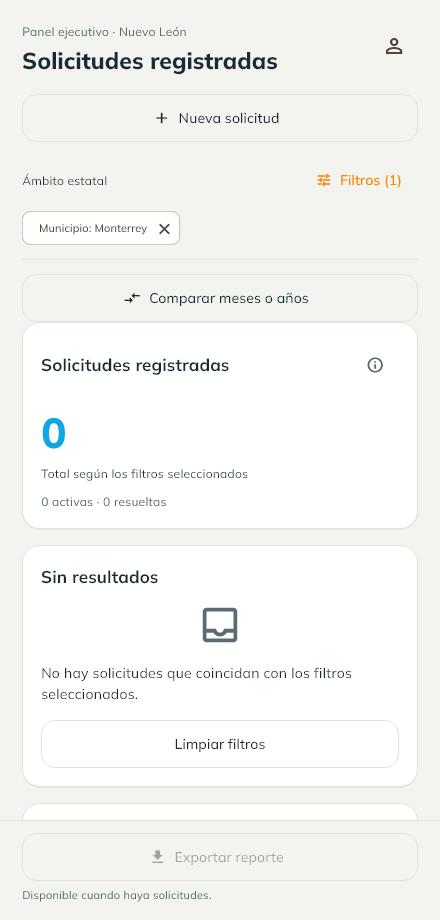
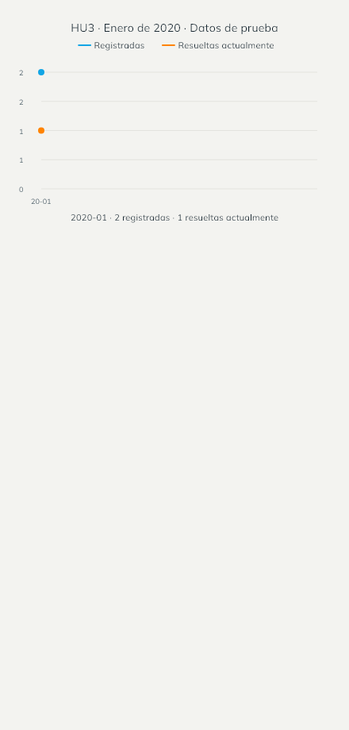

# Pruebas del sprint 1 de SIEASAS

Fecha: 28 de septiembre de 2026. Proyecto probado: `C:\Users\aldop\SIESAS\SGSC`.

## Resultado

Se ejecutaron pruebas unitarias, pruebas de rutas FastAPI con dependencias simuladas y pruebas funcionales de componentes Flutter. Se utilizó el código real del proyecto y datos ficticios. **La integración con MySQL y la entrega real de correo no se ejecutaron.**

| Ejecución final | Aprobadas | Fallidas | Omitidas |
|---|---:|---:|---:|
| Backend: reglas, servicios y rutas aisladas | 42 | 0 | 5 |
| Flutter: componentes e interacciones con API simulada | 53 | 0 | 0 |
| Total de pruebas automatizadas | 95 | 0 | 5 |

De las 42 pruebas aprobadas del backend, 34 corresponden a modelos, funciones y servicios aislados, y 8 a rutas HTTP con dependencias simuladas. Esta clasificación se verificó contra los casos del reporte JUnit. El texto de tesis desarrolla las unitarias por historia en 4.3.6.2 y presenta el desglose y la evidencia en 4.3.6.3.

La suite completa incluye regresiones de comparación, exportaciones y presentación existentes. **Estos números no representan 100 criterios de aceptación del sprint**: algunas pruebas cubren varias verificaciones, otras son variantes de plataforma y cinco requieren MySQL. El análisis estático de Flutter no reportó problemas; su salida se conserva en `evidencias/flutter_analyze.txt`.

Se añadieron 27 casos de backend, contando las variantes parametrizadas, en `backend/tests/test_sprint1.py`, tres pruebas Flutter en `sgsc_ejecutiva/test/sprint1_test.dart` y cuatro verificaciones/capturas complementarias al archivo existente de registro. Posteriormente se corrigió únicamente la construcción de la tendencia de HU3 en `backend/app/services/executive_service.py`. Se mantuvieron las consultas SQL y los controles de acceso existentes.

## Base documental

Las historias corresponden a **Copia de TESIS.docx.pdf**, sección 4.3 y anexos E.1, E.3, E.4 y E.5 (páginas PDF 105-106, 168 y 170-172). El orden utilizado es HU1, HU5, HU4 y HU3.

La presentación sigue el ejemplo del sprint 2 de Nancy, José Manuel Sedano y Diego Mejía, sección 4.4.6, páginas PDF 214-230: propósito por historia, verificaciones concretas y capturas explicadas. Se tomó únicamente como ejemplo de organización; los resultados de ese trabajo no son evidencia de SIEASAS.

## HU1. Recuperar contraseña

Se verificó la validación del correo y el envío de la solicitud desde la interfaz. Un correo inválido impidió enviar la petición; uno válido llevó a la pantalla «Revisa tu correo» con una respuesta genérica.

En las rutas aisladas se comprobó que dos direcciones de prueba recibieran el mismo mensaje y código 202. La función de entrega se sustituyó por un registro en memoria, por lo que esta prueba demuestra la programación de la entrega, no la existencia de las cuentas ni la recepción del correo.

Las pruebas de reglas comprobaron longitudes de 14, 15, 128 y 129 caracteres: recuperación y registro rechazaron los extremos inválidos y aceptaron 15 y 128. La ruta de restablecimiento rechazó una credencial declarada inválida por el doble de validación, sin escrituras. Ante una credencial declarada válida, generó un hash verificable de la nueva contraseña y solicitó invalidar los tokens pendientes. Esta última comprobación verifica las instrucciones emitidas; no acredita persistencia ni inicio de sesión posterior.



*Figura de prueba HU1. Mensaje genérico mostrado por la interfaz real con una respuesta HTTP simulada. No prueba entrega SMTP.*

**Pendiente:** recepción en buzón de pruebas, inicio de sesión con la nueva contraseña, rechazo de la anterior, vencimiento, reutilización y revocación de sesiones contra una base de pruebas.

## HU5. Registrar solicitud desde Ejecutivo

Se probó el formulario con beneficiario y solicitante existentes. La interfaz conservó los datos al volver al paso anterior, rechazó una descripción vacía y envió identificadores de personas, canal, descripción y clave de idempotencia. El callback recibió «Solicitud #9» de la API simulada.

Las pruebas aisladas verificaron el rechazo de campos obligatorios ausentes, el uso del estatus «Inicio» y del usuario autenticado en las instrucciones de registro. Ante un reintento identificado por el doble de consulta, el servicio devolvió la solicitud anterior sin ejecutar escrituras. También se comprobó que una petición sin sesión recibiera 401.



*Figura de prueba HU5-A. La descripción faltante impide continuar; la prueba verifica además que no se haya enviado el registro.*



*Figura de prueba HU5-B. Revisión de los datos antes del envío. Los expedientes y respuestas son ficticios.*

**Pendiente:** guardar con personas nuevas y existentes en MySQL, consultar la autoría y el origen persistidos, comprobar ausencia real de duplicados y validar el flujo ordinario posterior. «Solicitud #ID» es un identificador visible derivado de la clave, no un folio de negocio independiente. El origen remitente seleccionado y el registro auxiliar de autoría deben distinguirse al escribir la tesis.

## HU4. Profundizar desde indicadores

Se seleccionó Monterrey en la gráfica, se verificó que tanto el tablero como el listado enviaran `municipio_id=1`, se abrió la solicitud del listado y se regresó al tablero. La selección permaneció activa. La prueba utilizó un conjunto ficticio de una solicitud y comprobó la presentación del detalle.

En el backend se verificó que la consulta del detalle incluyera la entidad del usuario y que una consulta sin filas devolviera 404. También se rechazó el acceso sin sesión. Estas comprobaciones no sustituyen una prueba con dos ámbitos reales en MySQL.



*Figura de prueba HU4-A. Listado de la solicitud ficticia con el filtro de municipio conservado.*



*Figura de prueba HU4-B. Navegación al detalle permitido por la respuesta simulada.*

**Pendiente:** correspondencia de agregados y registros persistidos, acceso entre entidades y criterio de restricción de datos personales. La ruta revisada devuelve nombre y apellidos a un Ejecutivo autorizado de la entidad; no se encontró en esa ruta una rama de anonimización por permiso específico. No se da por cumplido el tercer criterio de HU4 sin definir y probar ese permiso.

## HU3. Indicadores con filtros

Se comprobaron selección múltiple, aplicación y limpieza de filtros, estado sin coincidencias y distinción entre error de conexión y ausencia de datos. Las rutas de resumen y listado recibieron la misma combinación de municipios y fechas en una prueba aislada. También se verificó la regla de inclusión del último día y el rechazo de un intervalo invertido.



*Figura de prueba HU3. La interfaz muestra cero y «Sin resultados» para una respuesta simulada vacía con filtro activo.*

**La incidencia INC-S1-01 fue corregida y su prueba aprobó**, como se documenta a continuación. Esto cierra el defecto de la tendencia histórica en la validación aislada; las comprobaciones de integración de la historia siguen pendientes.

## Incidencia INC-S1-01: tendencia histórica corregida

- Historia: HU3.
- Prueba original: `test_hu3_historical_period_keeps_trend_data`. Se conservó la aserción que detectó el fallo y se añadió la comprobación exacta del mes y sus valores.
- Antes: con dos solicitudes de enero de 2020, el resumen devolvía 2 y la tendencia sumaba 0 porque construía siempre los últimos doce meses respecto a hoy.
- Corrección: `dashboard()` pasa las fechas seleccionadas a `month_series()`. La serie recorre los meses de ese intervalo, incluidos los extremos, y completa con cero los meses sin movimientos. Sin fechas se conserva la ventana predeterminada de doce meses.
- Fechas abiertas: con solo fecha final, la serie parte del primer mes con datos, o de once meses antes del final si está vacía. Con solo fecha inicial, termina en el mes actual o en el último mes con datos si es posterior; nunca termina antes del inicio.
- Después: el resumen devuelve 2 y la tendencia contiene `2020-01`, con 2 registradas y 1 resuelta. La prueba original aprueba.
- Regresión adicional: siete variantes de backend verifican cambio de año, intervalo de trece meses, extremos abiertos y periodos vacíos. Una prueba Flutter comprueba que la gráfica presenta y permite seleccionar un único mes histórico.
- Evidencia anterior: `evidencias/antes_correccion_HU3/backend_aislado.txt` y `.xml` conservan el fallo original. La evidencia final está en `evidencias/backend_aislado.txt` y `.xml`.
- Estado: **corregida y verificada mediante pruebas aisladas**. No se modificó Aiven ni se ejecutaron las cinco pruebas de integración omitidas.



*Figura de prueba HU3-B. Componente real de tendencia con el resultado ficticio de enero de 2020. La etiqueta seleccionada muestra 2 registradas y 1 resuelta. Es una prueba del componente aislado, no una captura del servidor conectado a Aiven.*

## Trazabilidad de los 19 casos del plan inicial

«Parcial» indica comprobaciones aprobadas en un nivel aislado, pero falta al menos una parte del caso completo. No equivale a aprobar el criterio funcional integral.

| Caso | Estado del caso completo | Evidencia o limitación |
|---|---|---|
| HU1-F01 | Parcial | Interfaz, respuesta genérica y programación de entrega; buzón real pendiente. |
| HU1-F02 | Parcial | Hash y orden de revocación; persistencia e inicio de sesión pendientes. |
| HU1-F03 | Parcial | Respuesta idéntica con entrega sustituida; falta probar cuentas existentes/inexistentes reales. |
| HU1-F04 | Parcial | Credencial declarada inválida rechazada; vencimiento y reutilización reales pendientes. |
| HU1-F05 | Aprobado a nivel de modelo | Política de longitud común al registro y restablecimiento, cuatro límites probados. |
| HU5-F01 | Parcial | Interfaz con expedientes existentes y respuesta ficticia; alta real y personas nuevas pendientes. |
| HU5-F02 | Parcial | Autoría en instrucciones emitidas; origen y persistencia por verificar. |
| HU5-F03 | Parcial | Estatus Inicio y ausencia de prioridad en envío; flujo ordinario posterior pendiente. |
| HU5-F04 | Aprobado en componente/modelo | Descripción obligatoria, campos faltantes y ausencia de envío inválido. |
| HU5-F05 | Parcial | Reintento sin escrituras ante consulta simulada; concurrencia/persistencia pendientes. |
| HU5-F06 | Parcial | Acceso sin sesión rechazado; cuenta autenticada sin rol pendiente. |
| HU4-F01 | Parcial | Selección, listado y detalle ficticios; conteos reales y paginación pendientes. |
| HU4-F02 | Parcial | Municipio conservado; combinación de fechas en API, recorrido completo con periodo pendiente. |
| HU4-F03 | Pendiente | No se verificó una cuenta con restricción específica sobre datos personales. |
| HU4-F04 | Parcial | Consulta acotada por entidad y 404 sin filas; dos entidades reales pendientes. |
| HU3-F01 | Aprobado en servicio aislado | INC-S1-01 corregida: conserva el mes histórico y sus dos solicitudes; integración pendiente. |
| HU3-F02 | Parcial | Filtros consistentes en rutas e interacciones; recálculo con datos persistidos pendiente. |
| HU3-F03 | Aprobado en componente | Respuesta vacía produce estado sin resultados; consulta real pendiente. |
| HU3-F04 | Aprobado en componente | Selección, retiro, limpieza y deshacer verificados por la suite existente. |

## Entorno y reproducción

- Revisión base: `86f1dc0cee1157bdec9390dace5a8edf53046d8a`, más los archivos de prueba y la corrección de HU3 de esta entrega.
- Windows; Python 3.12.14; pytest 9.1.1; FastAPI 0.141.1; SQLAlchemy 2.0.54; Pydantic 2.13.5.
- Flutter 3.47.5; Dart 3.13.4.
- Backend aislado: `.env` deshabilitado, conexión configurada a un puerto local no utilizado y `RUN_DB_TESTS=0`; no se utilizaron credenciales de Aiven.
- Las pruebas de componentes usan `MockClient`; no se probaron Android/iOS en dispositivos ni navegador con backend real.

Desde la carpeta del proyecto:

```powershell
.\backend\.venv\Scripts\python.exe .\pruebas\sprint_1\ejecutar_aisladas.py
```

El ejecutor llama a pytest, a toda la suite Flutter y al análisis estático. Conserva logs, resultados JUnit, capturas y códigos de salida en `evidencias/`. Tras la corrección de HU3, las comprobaciones ejecutadas terminan con código 0; los casos MySQL se siguen registrando como omitidos. La configuración de Flutter se toma de `tools.local.json`.

Los cinco casos MySQL preexistentes permanecen omitidos; esta corrección se limita a HU3 y se verificó sin conexión a Aiven. No se ejecutaron migraciones ni cambios sobre bases existentes. La suite emite dos avisos de deprecación de dependencias, sin fallos funcionales en la ejecución final.

## Archivos de evidencia y uso en la tesis

- `evidencias/backend_aislado.txt` y `.xml`: ejecución final del backend.
- `evidencias/flutter_completo.txt`: ejecución final de las 53 pruebas Flutter.
- `evidencias/flutter_analyze.txt`: análisis estático.
- `evidencias/ejecucion.json`: comandos, fechas UTC y códigos de salida.
- `evidencias/interfaz/`: capturas generadas por pruebas con datos ficticios.
- Los archivos `*_base` y `flutter_sprint1.txt` conservan ejecuciones previas; no se suman a los resultados finales.

Para redactar la tesis, usar `TEXTO_PARA_TESIS.md`. Las figuras tienen etiquetas provisionales que deben ajustarse a la numeración definitiva. Conservar la aclaración sobre datos simulados y el historial de corrección de la incidencia; no convertir estos resultados en una declaración de validación integral.
