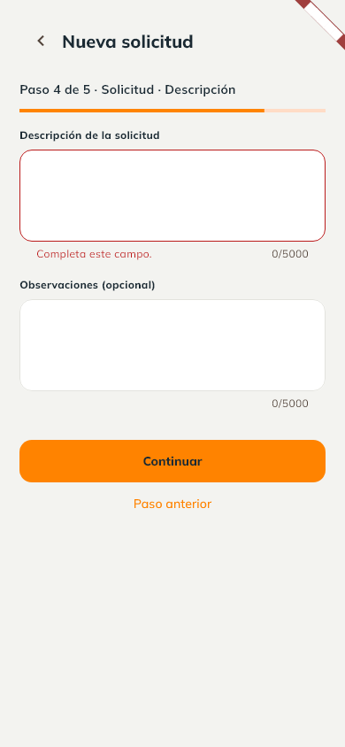
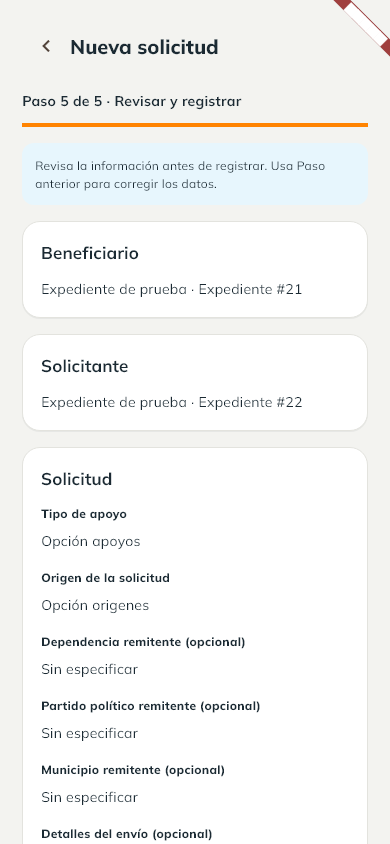
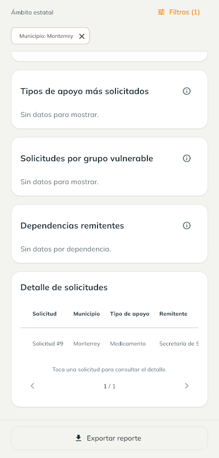
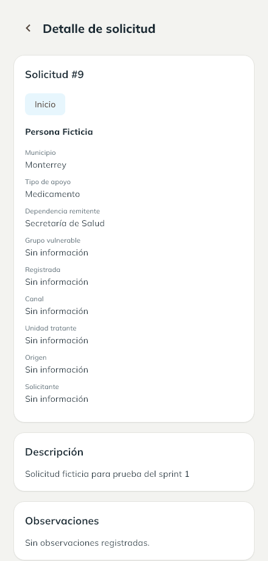
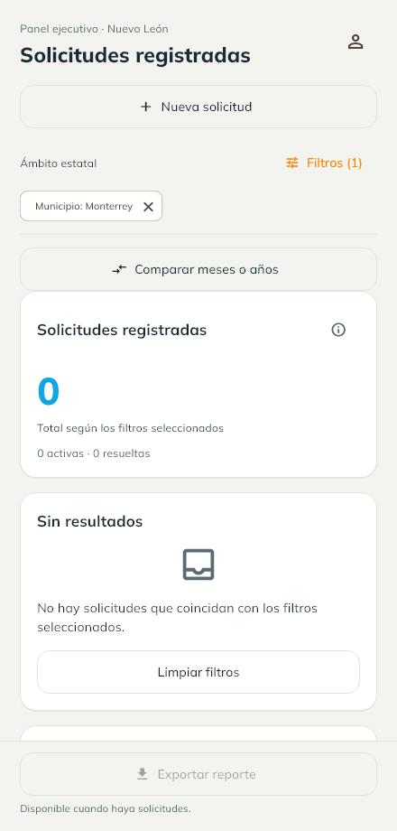
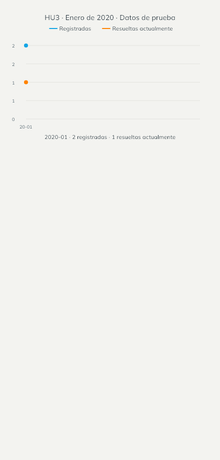

# Texto para incorporar a la tesis

Este texto describe la ejecución disponible al 28 de septiembre de 2026. La numeración de figuras es provisional. Las capturas se encuentran en `evidencias/interfaz/`.

## 4.3.6 Pruebas

Durante la validación de las funcionalidades del primer sprint se realizaron pruebas unitarias de las reglas del backend, pruebas de rutas de la API con dependencias simuladas y pruebas funcionales de componentes de la interfaz. El propósito fue revisar las historias de recuperación de contraseña, registro de solicitudes desde el perfil Ejecutivo, profundización desde indicadores y consulta de indicadores con filtros.

Se utilizaron datos ficticios y respuestas controladas para reproducir casos válidos, errores de validación y consultas sin resultados. La ejecución de regresión obtuvo 42 pruebas aprobadas y ninguna fallida en el backend, además de 53 pruebas aprobadas de Flutter. Cinco pruebas de integración con MySQL quedaron pendientes. Por tanto, estos resultados corresponden a una validación aislada y no acreditan todavía el funcionamiento completo con la base de datos y el servicio de correo.

### 4.3.6.1 Pruebas funcionales

#### Pruebas a la Historia de Usuario 1: Recuperar contraseña

Se realizaron pruebas enfocadas en la solicitud de recuperación y las reglas de restablecimiento:

1. **Solicitud de recuperación.** Se comprobó que un correo inválido impidiera el envío y que un correo válido generara la petición correspondiente. La interfaz mostró el mensaje genérico de recuperación recibido de la API simulada.
2. **Validación de contraseña.** Se verificó que el modelo de restablecimiento aplicara los mismos límites que el registro: de 15 a 128 caracteres. Los valores de 14 y 129 caracteres fueron rechazados.
3. **Credenciales temporales.** Se verificó que la ruta rechazara una credencial declarada inválida por el componente simulado de validación, sin emitir escrituras de cambio de contraseña. Para una credencial declarada válida, se comprobó la generación del hash y la solicitud de revocación de tokens.

*Figura S1-1. Respuesta genérica de recuperación de contraseña con API simulada.*

En la Figura S1-1 se observa el mensaje presentado después de solicitar la recuperación. La captura demuestra la respuesta de la interfaz; la recepción del correo, el vencimiento y uso único del enlace y el acceso posterior con la nueva contraseña requieren completar las pruebas de integración.

#### Pruebas a la Historia de Usuario 5: Registrar solicitud desde Ejecutivo

Se realizaron pruebas del formulario y de las reglas de registro:

1. **Selección de personas.** Se comprobó la selección de un beneficiario y un solicitante existentes mediante expedientes ficticios, así como el envío de sus identificadores.
2. **Campos obligatorios.** Se verificó que una descripción vacía impidiera continuar y que no se enviara la solicitud. También se comprobó que los datos se conservaran al regresar al paso anterior.
3. **Preparación del registro.** Se verificó el envío de la descripción, el canal y una clave de idempotencia. La interfaz procesó el identificador «Solicitud #9» devuelto por la respuesta simulada.
4. **Reglas del servicio.** Mediante dependencias simuladas, se comprobó que el servicio utilizara el estatus Inicio y el usuario responsable de la captura. Cuando la consulta identificó una operación anterior, devolvió su identificador sin emitir nuevas escrituras.

*Figura S1-2. Validación de descripción obligatoria en una solicitud ficticia.*

*Figura S1-3. Revisión de los datos de la solicitud antes del envío con API simulada.*

Las Figuras S1-2 y S1-3 muestran la validación y revisión del formulario. La persistencia del origen y del usuario de captura, el registro de personas nuevas y la ausencia de duplicados en MySQL permanecen pendientes de validación integrada.

#### Pruebas a la Historia de Usuario 4: Profundizar desde indicadores

Se realizaron pruebas de navegación y conservación del contexto:

1. **Selección de una categoría.** Se seleccionó un municipio y se verificó que tanto el tablero como el listado solicitaran información con el mismo filtro.
2. **Consulta del detalle.** Se abrió una solicitud ficticia del listado y se comprobó la presentación de su detalle. Al regresar al tablero, el municipio seleccionado permaneció activo.
3. **Ámbito de consulta.** Se verificó que la consulta del backend incluyera la entidad del usuario y que una respuesta sin registros produjera un error de solicitud no encontrada. También se comprobó el rechazo del acceso sin sesión.

*Figura S1-4. Listado de solicitudes con un filtro de municipio activo y datos ficticios.*

*Figura S1-5. Detalle de una solicitud obtenido mediante una respuesta simulada.*

Las Figuras S1-4 y S1-5 muestran la transición del listado al detalle. Queda pendiente comprobar el acceso entre entidades con datos persistidos y el criterio de limitación o anonimización de datos personales para usuarios con permisos restringidos.

#### Pruebas a la Historia de Usuario 3: Indicadores con filtros

Se realizaron pruebas de aplicación de filtros y presentación de resultados:

1. **Combinación de criterios.** Se comprobó que las rutas de resumen y listado recibieran la misma selección de municipios y fechas. Se verificó la inclusión del último día de consulta y el rechazo de periodos invertidos.
2. **Interacción con filtros.** Se probaron la selección múltiple, la aplicación, el retiro y la limpieza de criterios.
3. **Ausencia de datos.** Ante una respuesta simulada sin coincidencias, la interfaz mostró el estado «Sin resultados» y permitió limpiar los filtros. Los errores de conexión se presentaron como errores, sin sustituirlos por un resultado vacío.
4. **Consistencia de periodos históricos.** Se detectó una inconsistencia en la tendencia: al proporcionar dos solicitudes correspondientes a enero de 2020, el resumen conservó el total de dos, mientras que la tendencia mostró un total de cero. La causa fue que la serie se limitaba a los últimos doce meses respecto a la fecha actual. Se corrigió la construcción de la serie para que utilizara las fechas seleccionadas y completara con cero los meses sin movimientos. Al repetir la prueba, tanto el resumen como la tendencia conservaron las dos solicitudes de enero de 2020. También se verificaron intervalos que cruzan un año, periodos mayores a doce meses y consultas vacías.

*Figura S1-6. Estado sin resultados para un filtro activo, con respuesta simulada.*

En la Figura S1-6 se observa la presentación de una consulta sin coincidencias. La inconsistencia de periodos históricos quedó corregida y la prueba que la detectó fue aprobada. Las pruebas de integración pendientes impiden considerar concluida la validación integral de esta historia.

*Figura S1-7. Componente de tendencia con un mes histórico ficticio: 2 solicitudes registradas y 1 resuelta actualmente.*

La Figura S1-7 muestra la selección de enero de 2020 en una prueba aislada del componente. Esta evidencia complementa la prueba del backend que verificó la conservación del periodo histórico.

### 4.3.6.2 Pruebas unitarias

Las pruebas unitarias se realizaron para verificar reglas y funciones específicas del backend de manera aislada. Se utilizó pytest para ejecutar los casos y comparar los resultados obtenidos con los valores esperados. En las funciones que dependían de consultas o escrituras se emplearon objetos simulados, mediante Mock y monkeypatch, que proporcionaron respuestas controladas sin conectarse a MySQL.

Se incluyeron datos válidos, campos ausentes, valores límite y periodos sin información. Cada caso se consideró aprobado cuando sus comprobaciones se cumplieron; por ejemplo, cuando una entrada inválida produjo el rechazo esperado o cuando una serie mensual conservó exactamente los registros del intervalo consultado. Estas pruebas complementan la revisión funcional de la interfaz y permiten localizar errores en reglas concretas.

#### Pruebas unitarias relacionadas con la Historia de Usuario 1: Recuperar contraseña

Se verificó que los modelos de registro y restablecimiento aplicaran la misma política de longitud. Se probaron contraseñas de 14, 15, 128 y 129 caracteres: se rechazaron las de 14 y 129, y se aceptaron las de 15 y 128. Los cuatro casos resultaron aprobados.

Como comprobaciones de apoyo al proceso de recuperación, se verificaron la compatibilidad de la validación con un hash bcrypt de formato utilizado por PHP, el rechazo de una contraseña incorrecta y el manejo de un hash inválido. También se probaron la construcción del correo de recuperación, la sustitución de un token anterior en el enlace y el tratamiento de caracteres especiales en la plantilla HTML. Estas comprobaciones validaron la preparación del mensaje; no implicaron el envío ni la recepción de correo real.

#### Pruebas unitarias relacionadas con la Historia de Usuario 5: Registrar solicitud desde Ejecutivo

Se verificó el rechazo del modelo de solicitud al omitir, por separado, la selección del beneficiario, la selección del solicitante, la descripción y el canal de recepción. También se comprobó que el modelo de beneficiario rechazara una fecha de nacimiento futura. En todos estos casos se obtuvo el error de validación esperado.

En el servicio de registro se simularon las respuestas de la base de datos para comprobar dos decisiones. Primero, cuando la consulta identificó una operación registrada previamente, el servicio devolvió su identificador sin solicitar nuevas escrituras. Segundo, para una operación nueva con personas existentes, se comprobó que las instrucciones de guardado utilizaran el estatus Inicio y el identificador del usuario responsable. Ambas pruebas fueron aprobadas. La ausencia de duplicados y la autoría persistida deberán comprobarse también en la integración con MySQL.

#### Pruebas unitarias relacionadas con la Historia de Usuario 4: Profundizar desde indicadores

Se verificó la función compartida que construye las condiciones de consulta. Al proporcionar una entidad y filtros de municipio y dependencia, la condición resultante conservó la restricción por entidad y mantuvo los valores como parámetros separados de la consulta. La prueba fue aprobada y respalda la conservación del ámbito al preparar consultas.

Esta comprobación no demuestra por sí sola la autorización completa ni la anonimización de datos personales. La respuesta del endpoint de detalle se evaluó adicionalmente mediante pruebas de API con dependencias simuladas, descritas en el apartado funcional; se distingue de la prueba unitaria de construcción de condiciones.

#### Pruebas unitarias relacionadas con la Historia de Usuario 3: Indicadores con filtros

Se verificaron las reglas de combinación de filtros: varios valores de un mismo criterio se trataron como alternativas y los criterios distintos conservaron sus respectivas condiciones. También se comprobaron la eliminación de valores repetidos, el rechazo de identificadores inválidos y la validación de un periodo cuya fecha inicial fuera posterior a la final. La construcción de la condición de fecha final incluyó el día completo; esta comprobación inspeccionó la condición generada, sin ejecutar SQL contra MySQL.

Para la tendencia mensual se probaron cambios de año, meses sin movimientos, periodos de trece meses y consultas con un extremo de fecha abierto. Los meses sin registros conservaron valores de cero y los meses con información mantuvieron sus cantidades de solicitudes registradas y resueltas.

La prueba de enero de 2020 permitió identificar la incidencia INC-S1-01: el resumen contenía dos solicitudes, pero la tendencia las descartaba. Después de corregir la construcción del intervalo, se repitió la misma comprobación y se obtuvo una tendencia con dos solicitudes registradas y una resuelta en enero de 2020. La prueba quedó aprobada y se conservó para detectar una posible reaparición del defecto.

*Tabla S1-1. Resumen de verificaciones unitarias representativas del sprint 1.*

| Historia | Regla o función evaluada | Entrada o condición | Resultado obtenido |
|---|---|---|---|
| HU1 | Longitud de contraseña | 14, 15, 128 y 129 caracteres | Rechazo de 14 y 129; aceptación de 15 y 128. |
| HU1 | Preparación del enlace de recuperación | URL con token anterior | Sustitución por el token de prueba y codificación segura en HTML. |
| HU5 | Datos obligatorios | Omisión individual de persona, descripción o canal | Error de validación esperado. |
| HU5 | Reintento de registro | Consulta simulada que identifica una operación anterior | Retorno de la solicitud original sin nuevas escrituras. |
| HU5 | Estado inicial y autoría | Registro con usuario ficticio 42 | Instrucciones de guardado con estatus Inicio y usuario 42. |
| HU4 | Ámbito de consulta | Entidad y filtros de municipio y dependencia | Restricción de entidad conservada y valores parametrizados. |
| HU3 | Serie histórica | Enero de 2020: 2 registradas y 1 resuelta | Conservación del mes y de ambas cantidades después de la corrección. |
| HU3 | Meses sin registros | Intervalos con huecos o sin movimientos | Meses del intervalo con valores de cero. |

La tabla resume grupos de verificaciones y no equivale al número total de pruebas automatizadas. Algunas reglas se ejecutaron con varias entradas mediante casos parametrizados.

### 4.3.6.3 Resultados y evidencia de ejecución

La revisión de los casos ejecutados permitió distinguir las pruebas unitarias de las pruebas de rutas HTTP y de componentes visuales. Las 42 pruebas aprobadas del backend se distribuyeron en 34 pruebas unitarias de modelos, funciones y servicios aislados, y 8 pruebas de rutas de la API con dependencias simuladas. Estas cantidades incluyen las comprobaciones de regresión existentes, por lo que no representan exclusivamente pruebas nuevas ni un porcentaje de cobertura de código.

*Tabla S1-2. Resultados de la ejecución automatizada.*

| Tipo de prueba | Aprobadas | Fallidas | Omitidas |
|---|---:|---:|---:|
| Unitarias del backend | 34 | 0 | 0 |
| Rutas de la API con dependencias simuladas | 8 | 0 | 0 |
| Componentes e interacciones de Flutter con API simulada | 53 | 0 | 0 |
| Integración con MySQL | 0 | 0 | 5 |
| Total | 95 | 0 | 5 |

Los resultados individuales del backend se conservaron en `backend_aislado.txt` y en el reporte JUnit `backend_aislado.xml`; los de Flutter, en `flutter_completo.txt`. Estos registros respaldan los conteos de la Tabla S1-2 y pueden incorporarse como anexo de evidencia. Las capturas del apartado anterior documentan el comportamiento visual, mientras que los registros de ejecución respaldan las comprobaciones unitarias.

Se conservaron tanto el fallo inicial de INC-S1-01 como la ejecución aprobada después de la corrección. Las cinco pruebas de integración omitidas permanecen pendientes; por ello, el resultado acredita las comprobaciones aisladas realizadas y no la validación completa contra MySQL o el servicio de correo.
