# Cambios al módulo Ejecutivo después de la prueba de usabilidad

Prueba realizada el 10 de noviembre de 2026 con 4 participantes. Cada cambio indica qué observamos en la prueba, qué se hizo y las capturas de antes y después (en rojo, lo que cambió). Todas las capturas son de la app en tamaño celular (375 × 812).

---

## Tarea 1 · Entender el panel

**Resultados:** 3 sin ayuda, 1 no completada · SEQ promedio 5.75 / 7.

**Lo que observamos**
- La app no parecía tener más contenido abajo: la tabla de solicitudes (casi dos pantallas, con paginación «1 / 56») quedaba justo debajo del total y parecía el final.
- Al buscar «qué municipio tiene más», usaban el buscador de la tabla o filtraban municipio por municipio.
- El total y su desglose (activas, resueltas, no son competencia, cerradas) se perdían en una línea gris.
- En el mapa no se podía saber qué municipio era cuál.

**Cambios**
| # | Cambio | Antes | Después |
|---|---|---|---|
| 1 | El panel se divide en dos pestañas fijas arriba: **Resumen** (indicadores) y **Solicitudes** (buscador y tabla). | 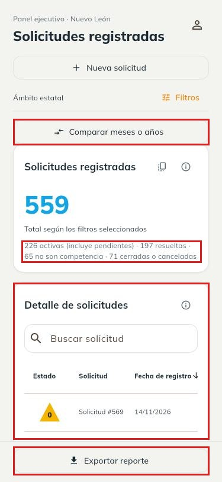 | 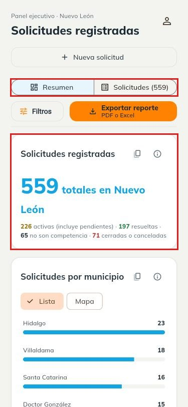 |
| 2 | El total dice su alcance: «559 totales en Nuevo León» o «23 solicitudes filtradas». |  | 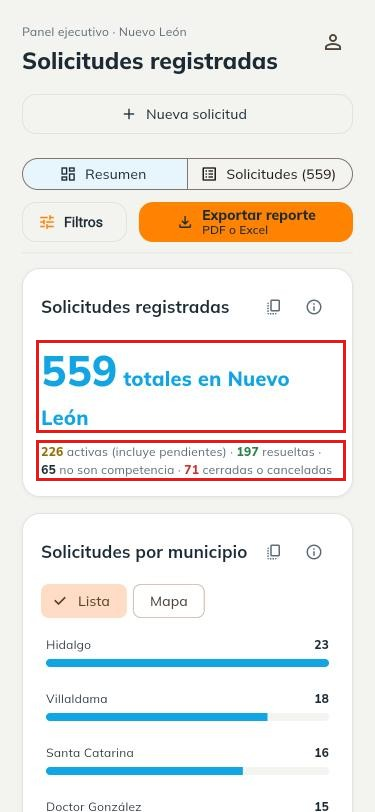 |
| 3 | En el desglose, cada número va en negritas y en el color de su estatus (verde resueltas, rojo cerradas, ámbar activas). |  |  |
| 4 | Municipios en una sola tarjeta con selector **Lista / Mapa**; la lista (ranking) aparece primero. | 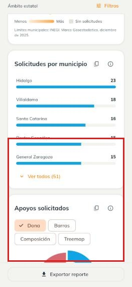 | 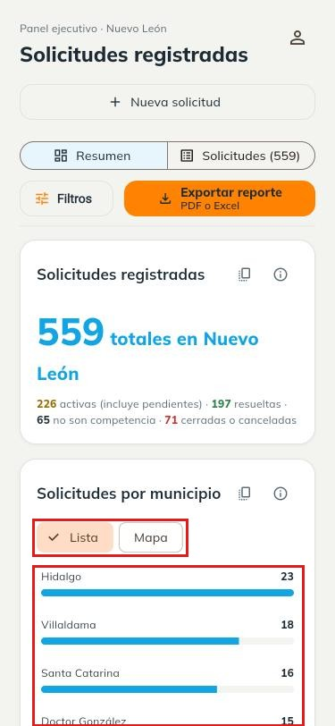 |
| 5 | El mapa muestra el nombre de los municipios que caben en pantalla y más nombres al acercar (pellizcar o botones + / −). | 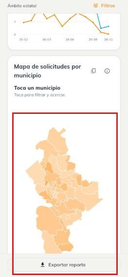 | 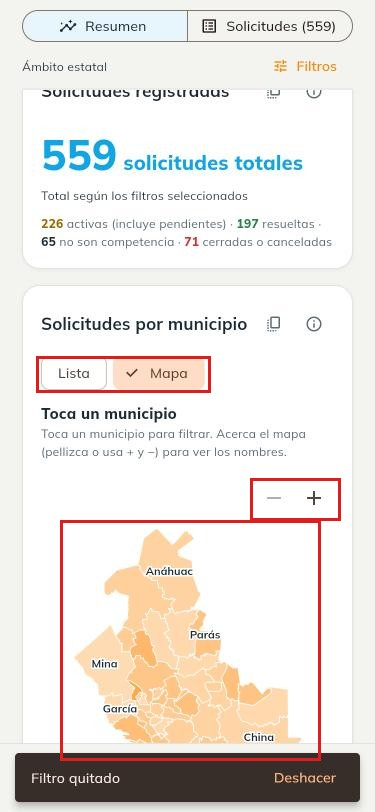 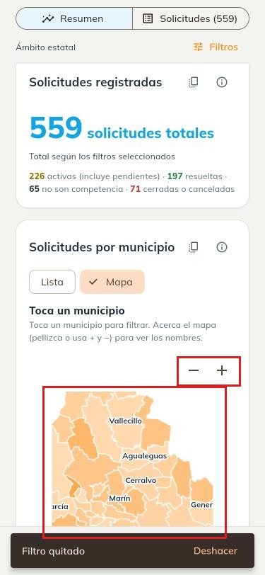 |
| 6 | El filtro de municipio muestra cuántas solicitudes tiene cada uno y se ordena por «Más solicitudes» o «A–Z». | 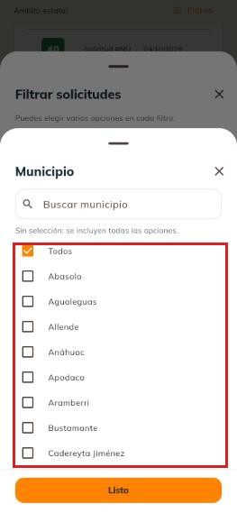 | 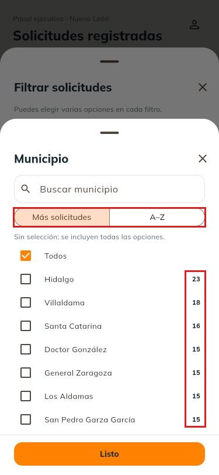 |
| 7 | «Comparar meses o años» pasó a la parte de tendencia; se quitó «Ámbito estatal». |  |  |
| 8 | El aviso «Filtro quitado» se quita solo a los 3 segundos (antes no se quitaba) y ya no tapa «Exportar», que subió; es semitransparente, con ícono y «Deshacer» en naranja. | — | 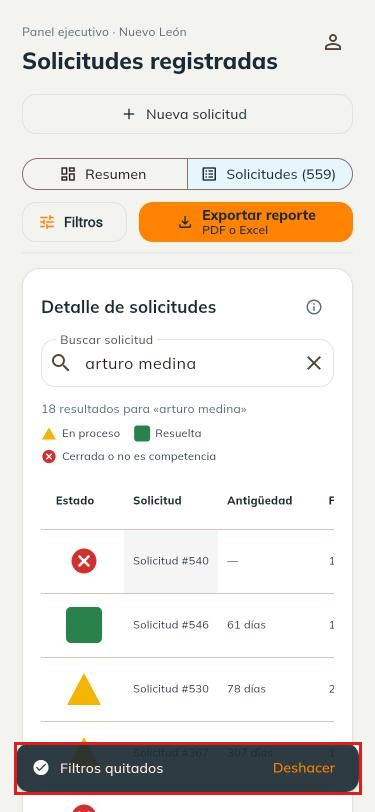 |

---

## Tarea 2 · Encontrar una solicitud

**Resultados:** 4 sin ayuda · SEQ promedio 6.5 / 7.

**Lo que observamos**
- Entre todas las solicitudes de Arturo Medina no se distinguía el tipo de apoyo ni la fecha.
- Un participante tenía un filtro de municipio puesto, buscó a Arturo, no le salió nada y no se dio cuenta de que el filtro era la causa.
- Otro participante buscó a Arturo y abrió la primera sugerencia sin comparar.
- El filtro aplicado («Municipio: Santa Catarina») se perdía visualmente.

**Cambios**
| # | Cambio | Antes | Después |
|---|---|---|---|
| 1 | En las sugerencias, el **tipo de apoyo y la fecha** van primero y en negritas, con el ícono de estatus de la tabla. | 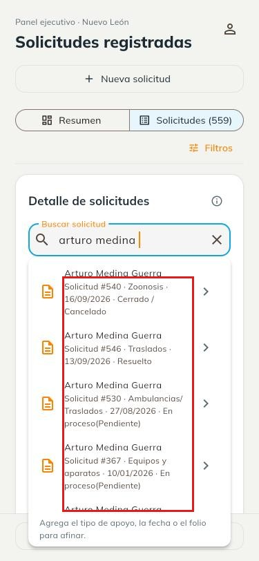 | 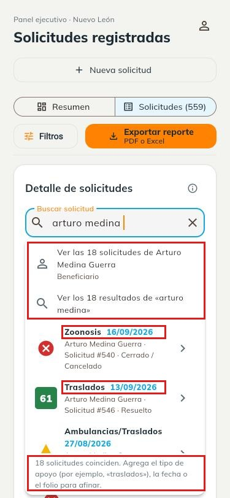 |
| 2 | Primero se ofrece «Ver las N solicitudes de …» para comparar en la tabla, antes de abrir una sola. |  |  |
| 3 | Los filtros aplicados se ven como filtro: «Filtrando por:», chip naranja y el valor en negritas. | 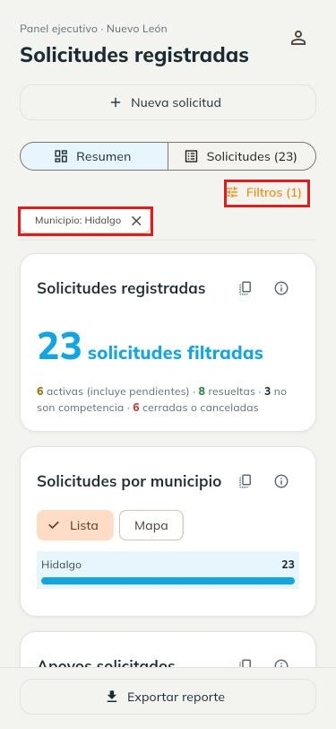 | 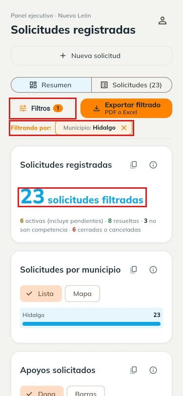 |
| 5 | El número sale del ícono de estado (se confundía con el folio) y pasa a su propia columna **Antigüedad** («8 días», «Hoy»); arriba de la tabla, una leyenda explica cada ícono (en celular no hay hover). | 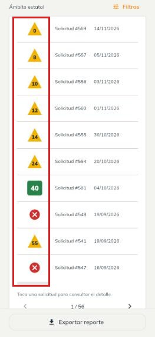 | 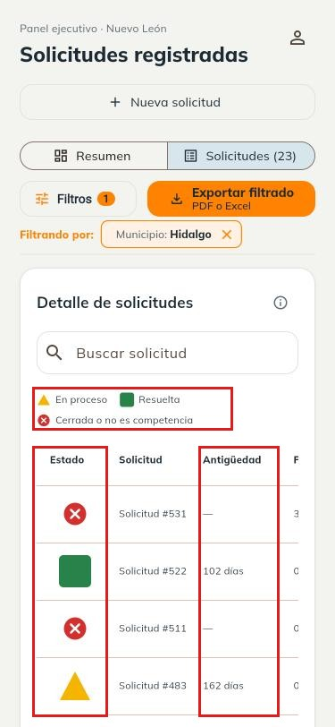 |
| 4 | Si una búsqueda no encuentra nada por un filtro, lo dice y ofrece «Buscar sin filtros». |

---

## Tarea 3 · Filtrar

**Resultados:** 4 sin ayuda · SEQ promedio 6.5 / 7. Sin cambios.

---

## Tarea 4 · Obtener el reporte

**Resultados:** 2 sin ayuda, 2 no completadas · SEQ promedio 6.25 / 7.

**Lo que observamos**
- Los participantes no encontraban el botón de exportar: era un botón delineado gris, igual que cualquier otro.
- No era claro que «reporte» fuera un archivo, ni que el reporte respeta los filtros aplicados.
- El botón de filtros parecía un enlace, no un botón.

**Cambios**
| # | Cambio | Antes | Después |
|---|---|---|---|
| 1 | **«Exportar (PDF o Excel)»** sube a la barra fija, junto a «Filtros» (filtrar y exportar quedan juntos, como en Google Analytics o Power BI). Se quitó la barra fija de abajo, que la vista terminaba ignorando. Botón principal de la app (naranja) y ya no se apaga mientras el panel se actualiza. |  | 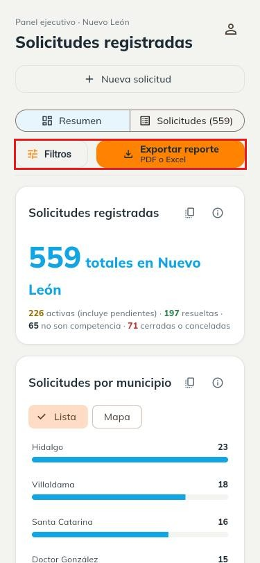 |
| 2 | Con filtros, el botón dice **«Exportar filtrado · PDF o Excel»** (sin filtros: «Exportar reporte · PDF o Excel») y los filtros aplicados aparecen justo debajo: se ve qué contendrá el reporte. |  | 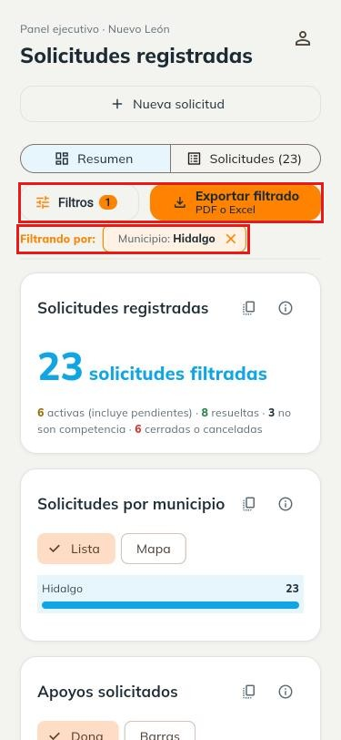 |
| 3 | «Filtros» pasa de enlace a botón, con el mismo estilo que los demás botones de la app (para no confundirse con los filtros aplicados, que son naranjas); con filtros muestra cuántos hay en una insignia naranja. |  |  | 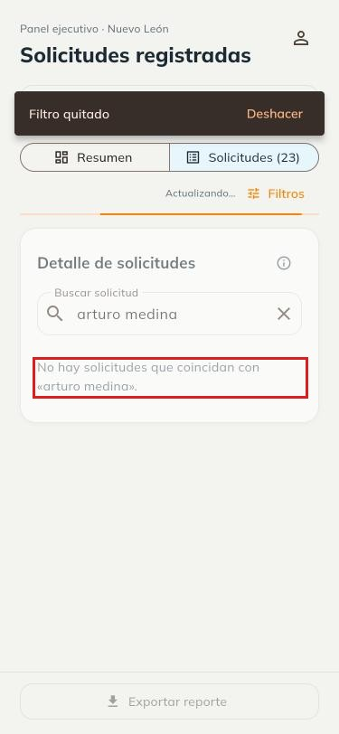 | 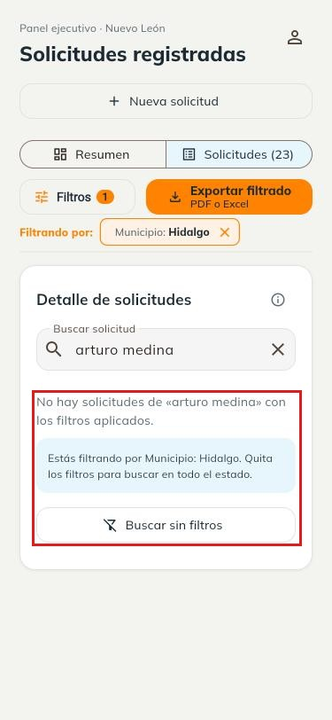 |
