# Cambios a la app del Ciudadano después de la prueba de usabilidad

Prueba del 13 y 14 de noviembre de 2026 (SEQ de 3 participantes y SUS de 4; faltan 2 pruebas). Cada cambio indica lo observado, lo que se hizo y las capturas de antes y después, con lo que cambió en rojo. Capturas en tamaño celular (375 × 812).

## Resultados al momento

| Tarea | SEQ (1–7) | Sin ayuda | Con ayuda | No completada |
|---|---|---|---|---|
| 1 · Crear cuenta y completar perfil | 6.67 | 2 | 1 | 0 |
| 2 · Solicitar apoyo para un familiar | 6.67 | 3 | 0 | 0 |
| 3 · Consultar el avance | 6.33 | 2 | 1 | 0 |
| 4 · Actualizar datos de contacto | 7.00 | 3 | 0 | 0 |

## Lo que observamos

- **Tarea 1:** los 3 participantes escribieron primero su correo en «Iniciar sesión»; no vieron «Crear cuenta», que era un enlace al final.
- **Tarea 2:** no sabían si la relación iba desde ellos o desde el beneficiario («¿pongo hijo o padre?»); una persona escribió los apellidos en el campo del nombre; una persona pidió la ayuda equivocada entre andadera y silla de ruedas.
- **Tareas 3 y 4:** el perfil (solo un ícono de silueta) no se identificaba; «Cerrar sesión» no se entendía como salir de la cuenta. Se sugirió ver en la solicitud el teléfono de contacto vigente.
- **General:** los campos opcionales se creían obligatorios: «(opcional)» en gris no se leía.

## Cambios

| # | Cambio | Antes | Después |
|---|---|---|---|
| 1 | **Bienvenida con dos opciones** (según el boceto del equipo): «Entrar a mi cuenta» (si ya te registraste) y «Registrarme por primera vez» (si es la primera vez). Antes se abría directo «Iniciar sesión» con «Crear cuenta» como enlace al final. | 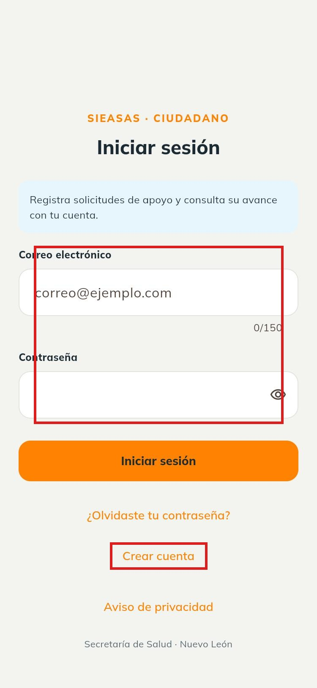 | 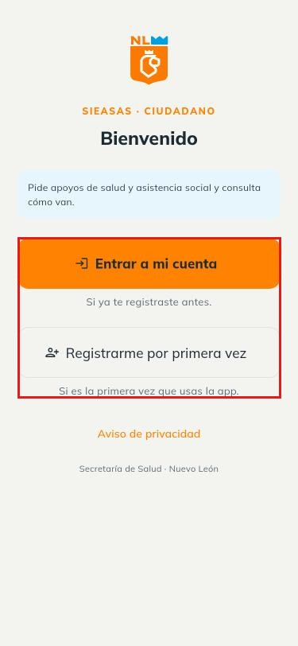 |
| 2 | Cada opción lleva a su propia pantalla, con «‹ Regresar» y el enlace para cambiar a la otra. |  |  |
| 3 | El ícono de perfil pasa a botón con texto **«Mis datos»**, más claro para adultos mayores. |  |  |
| 4 | La relación se elige de una lista **desde quien pide**: «¿Qué es esta persona para ti?» → «Mi papá», «Mi mamá», «Mi hijo o hija»…, con el ejemplo «si la pides para tu papá, elige *Mi papá*»; «Otro» abre un campo para escribirla. |  | 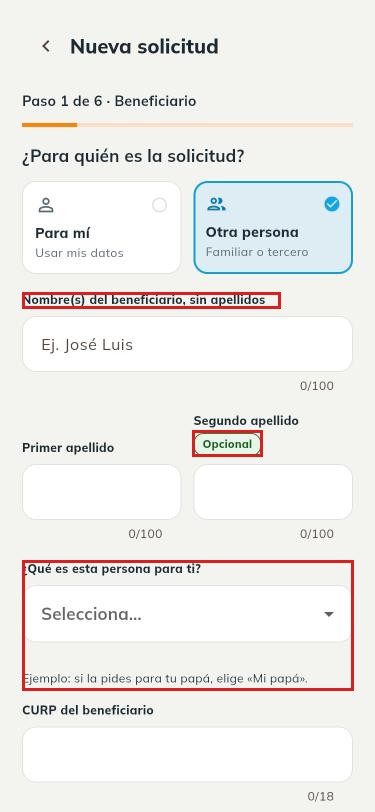  |
| 5 | El nombre dice **«Nombre(s), sin apellidos»** con el ejemplo «José Luis» (beneficiario y perfil). |  |  |
| 6 | **Andadera y silla de ruedas sin traslape:** «Silla de ruedas o ayuda técnica» (una andadera también es ayuda técnica) pasa a «Silla de ruedas», y «Andadera o bastón» a «Andadera, bastón o muletas». En la revisión final, el tipo de apoyo aparece primero y en mayúsculas. | 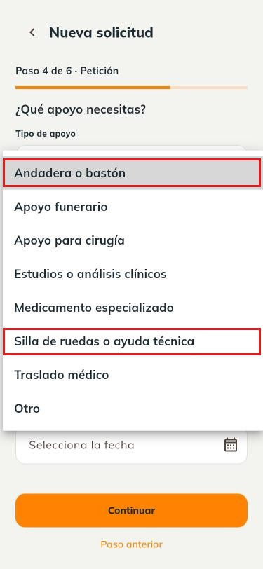 |  |
| 7 | El ejemplo del asunto decía «Ej. Solicitud de silla de ruedas» justo bajo el tipo de apoyo; ahora «Ej. Apoyo para mi papá», para no sugerir una opción. | 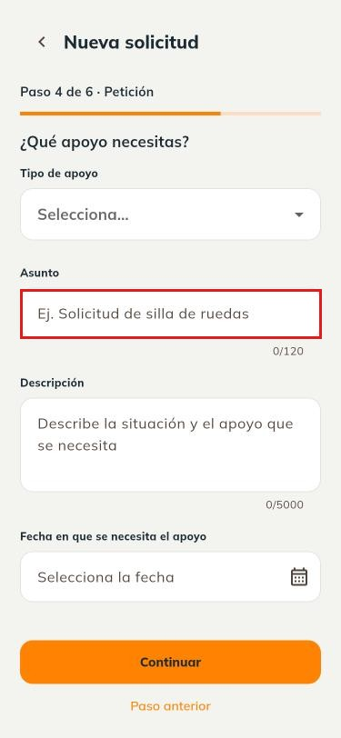 | 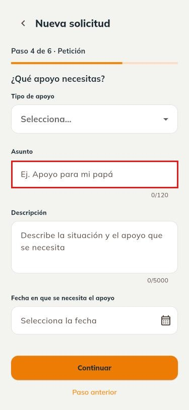 |
| 8 | Todos los campos opcionales llevan la etiqueta verde **«Opcional»** junto al nombre (segundo apellido, correo, medios de contacto, unidad médica, grupos vulnerables, referencias y documentos). | 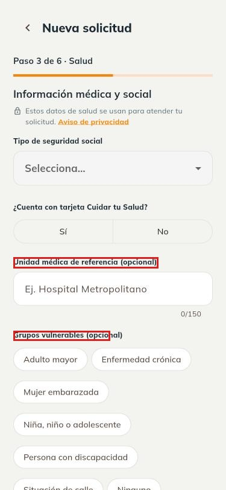 | 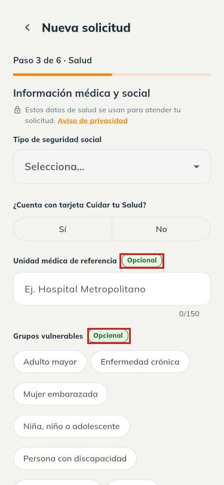 |
| 9 | El seguimiento de cada solicitud muestra **«Te contactaremos al»** con el celular y correo vigentes (si cambian en «Mis datos», cambian aquí). | 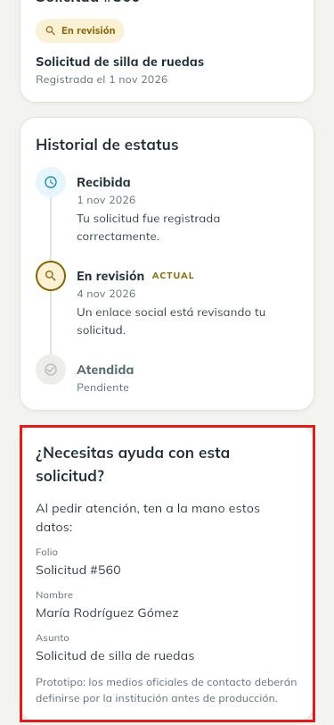 | 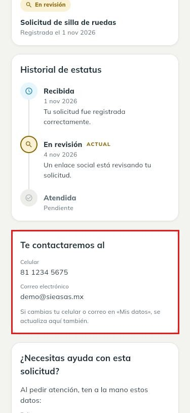 |
| 10 | «Cerrar sesión» pasa a **«Salir de mi cuenta»**, con confirmación «¿Salir de tu cuenta?». |  | 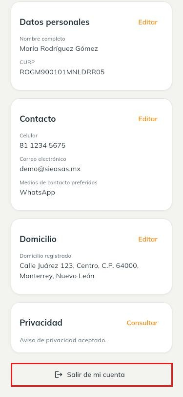 |

## Sobre la andadera y la silla de ruedas

Con un solo caso no se puede asegurar que fue la interfaz y no un descuido, pero había dos causas posibles en la interfaz: las opciones se enciman («ayuda técnica» incluye a la andadera) y el ejemplo del asunto mencionaba la silla de ruedas. Ambas se corrigieron.
