# Cambios a la app del Ciudadano después de la prueba de usabilidad

Prueba del 13 y 14 de noviembre de 2026 (SEQ de 3 participantes y SUS de 4; faltan 2 pruebas). Cada cambio indica lo observado, lo que se hizo y las capturas de antes y después, con lo que cambió en rojo. Capturas en tamaño celular (375 × 812).

## Resultados al momento

| Tarea | SEQ (1–7) | Sin ayuda | Con ayuda | No completada |
|---|---|---|---|---|
| 1 · Crear cuenta y completar perfil | 6.67 | 2 | 1 | 0 |
| 2 · Solicitar apoyo para un familiar | 6.67 | 3 | 0 | 0 |
| 3 · Consultar el avance | 6.33 | 2 | 1 | 0 |
| 4 · Actualizar datos de contacto | 7.00 | 3 | 0 | 0 |

## Lo que observamos

- **Tarea 1:** los 3 participantes escribieron primero su correo en «Iniciar sesión»; no vieron «Crear cuenta», que era un enlace al final.
- **Tarea 2:** no sabían si la relación iba desde ellos o desde el beneficiario («¿pongo hijo o padre?»); una persona escribió los apellidos en el campo del nombre; una persona pidió la ayuda equivocada entre andadera y silla de ruedas.
- **Tareas 3 y 4:** el perfil (solo un ícono de silueta) no se identificaba; «Cerrar sesión» no se entendía como salir de la cuenta. Se sugirió ver en la solicitud el teléfono de contacto vigente.
- **General:** los campos opcionales se creían obligatorios: «(opcional)» en gris no se leía.

## Cambios

| # | Cambio | Antes | Después |
|---|---|---|---|
| 1 | **Bienvenida con dos opciones** (según el boceto del equipo): «Entrar a mi cuenta» (si ya te registraste) y «Registrarme por primera vez» (si es la primera vez). Antes se abría directo «Iniciar sesión» con «Crear cuenta» como enlace al final. |  |  |
| 2 | Cada opción lleva a su propia pantalla, con «‹ Regresar» y el enlace para cambiar a la otra. |  | 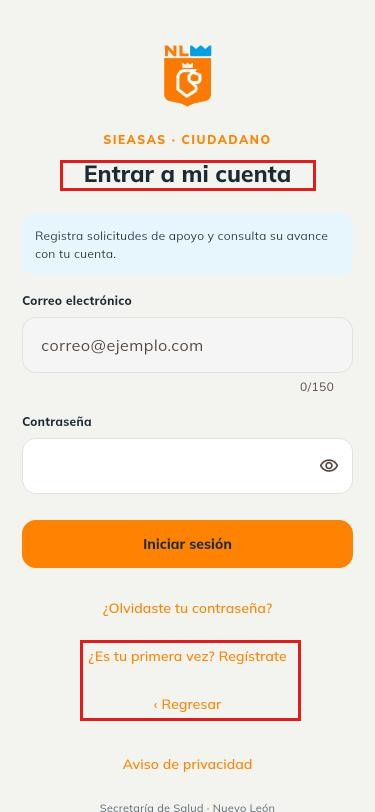 |
| 3 | El ícono de perfil pasa a botón con texto **«Mis datos»**, más claro para adultos mayores. | 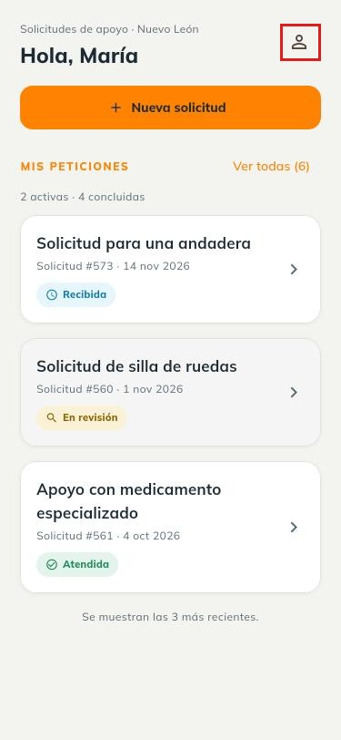 | 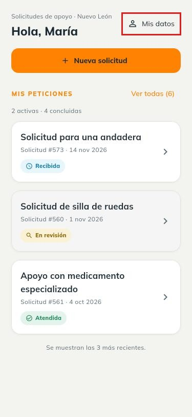 |
| 4 | La relación se elige de una lista **desde quien pide**: «¿Qué es esta persona para ti?» → «Mi papá», «Mi mamá», «Mi hijo o hija»…, con el ejemplo «si la pides para tu papá, elige *Mi papá*»; «Otro» abre un campo para escribirla. | 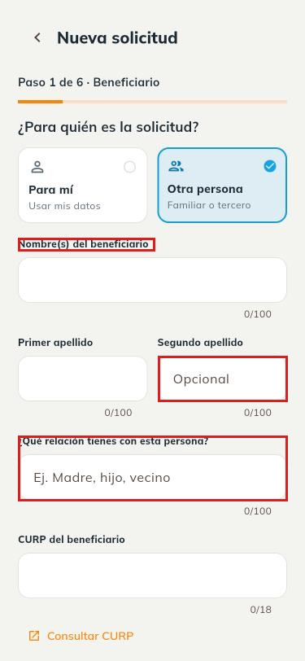 |   |
| 5 | El nombre dice **«Nombre(s), sin apellidos»** con el ejemplo «José Luis» (beneficiario y perfil). |  |  |
| 6 | **Andadera y silla de ruedas sin traslape:** «Silla de ruedas o ayuda técnica» (una andadera también es ayuda técnica) pasa a «Silla de ruedas», y «Andadera o bastón» a «Andadera, bastón o muletas». En la revisión final, el tipo de apoyo aparece primero y en mayúsculas. |  | 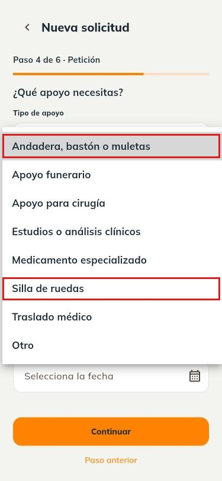 |
| 7 | El ejemplo del asunto decía «Ej. Solicitud de silla de ruedas» justo bajo el tipo de apoyo; ahora «Ej. Apoyo para mi papá», para no sugerir una opción. |  |  |
| 8 | Todos los campos opcionales llevan la etiqueta verde **«Opcional»** junto al nombre (segundo apellido, correo, medios de contacto, unidad médica, grupos vulnerables, referencias y documentos). |  |  |
| 9 | El seguimiento de cada solicitud muestra **«Te contactaremos al»** con el celular y correo vigentes (si cambian en «Mis datos», cambian aquí). |  |  |
| 10 | «Cerrar sesión» pasa a **«Salir de mi cuenta»**, con confirmación «¿Salir de tu cuenta?». | 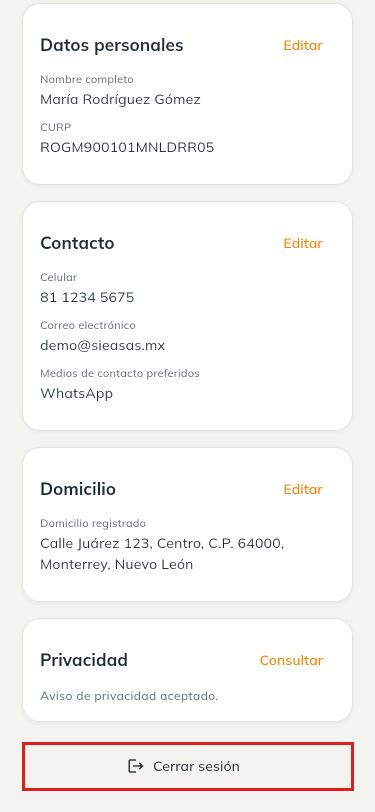 |  |

## Sobre la andadera y la silla de ruedas

Con un solo caso no se puede asegurar que fue la interfaz y no un descuido, pero había dos causas posibles en la interfaz: las opciones se enciman («ayuda técnica» incluye a la andadera) y el ejemplo del asunto mencionaba la silla de ruedas. Ambas se corrigieron.

---

# Segunda ronda de cambios

Comentarios de la segunda tanda de pruebas del Ciudadano. Mismo formato: lo observado, lo que se hizo y capturas de antes y después (cambios en rojo, tamaño celular 375 × 812).

## Lo que observamos

- **Contraseña:** en un celular no dejaba escribir la contraseña; los requisitos casi no se veían (letra chica y gris); el error «Repite la misma contraseña» seguía aunque ya coincidieran.
- **Errores tapados:** al tocar «Continuar» con datos faltantes, el teclado tapaba los mensajes en rojo y no se sabía por qué no avanzaba.
- **CURP:** nadie vio «Consultar CURP» debajo del campo.
- **Celular:** el ejemplo «81 1234 5678» parecía un número ya capturado.
- **Completar datos:** recién creada la cuenta no había forma de salir si no se tenían los datos a la mano.
- **Inicio:** «MIS PETICIONES» era muy chico y el saludo muy grande.
- **Parentesco:** debe usar el mismo catálogo que el módulo Ejecutivo (Cat_Parentescos), no una lista propia.
- **Seguridad social:** se entendía como la institución que daría el apoyo.
- **Opcional:** la marca todavía no se notaba; nadie llenó la unidad médica de referencia.
- **Recorrido guiado:** se pidió una explicación de primera vez de qué hace cada botón.

## Cambios

| # | Cambio | Antes | Después |
|---|---|---|---|
| 11 | **La contraseña se puede escribir en el celular.** En la versión web, el grupo de autollenado (correo + contraseña) impedía que el campo de contraseña tomara el foco al tocarlo en el navegador del celular; se reprodujo en pruebas y se quitó solo en web. Los **requisitos** ahora van en un recuadro con título «Tu contraseña debe tener:», letra más grande y oscura. | 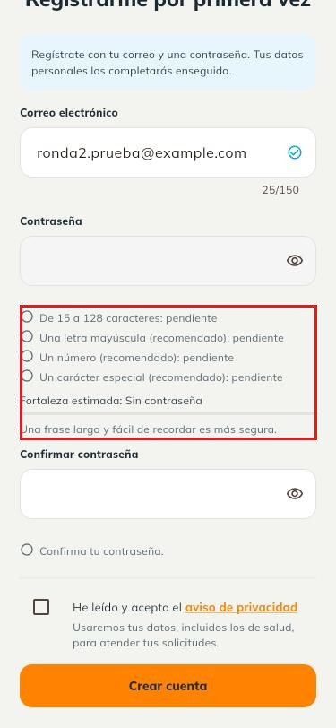 | 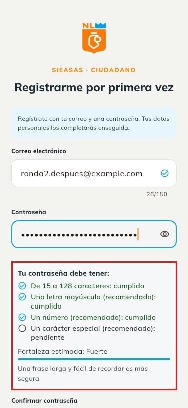 |
| 12 | **El error de confirmación se quita solo** en cuanto las contraseñas coinciden (antes seguía en rojo aunque ya coincidieran). | 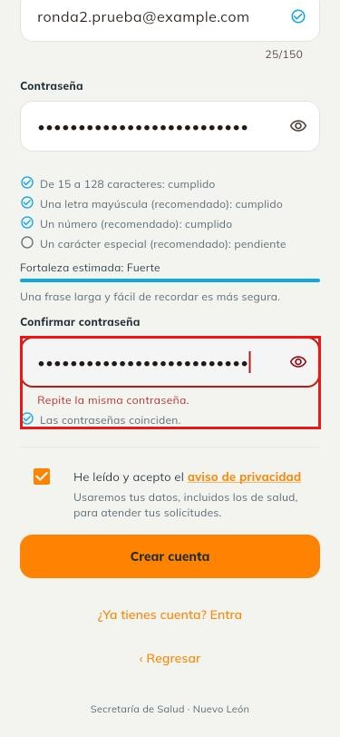 | 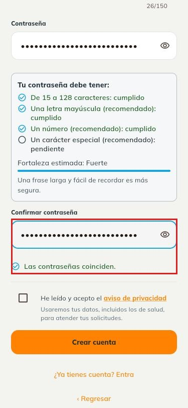 |
| 13 | **Aviso arriba con lo que falta:** al tocar «Continuar» con datos faltantes aparece arriba «Te falta revisar: …» con los nombres de los campos (no lo tapa el teclado), y la pantalla baja al primer campo con error. Aplica en registro, completar datos, nueva solicitud y Mis datos. | 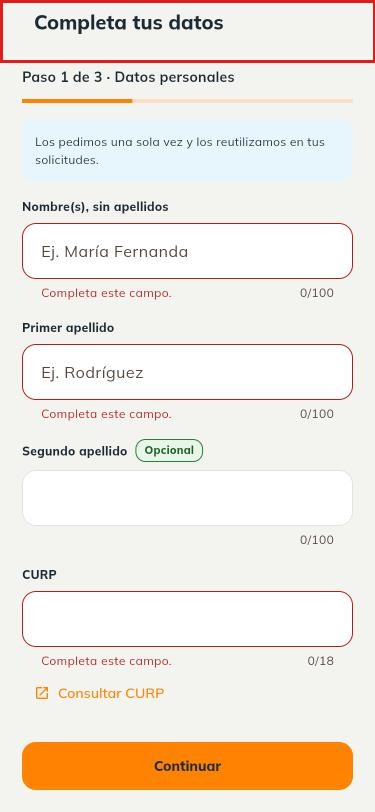 | 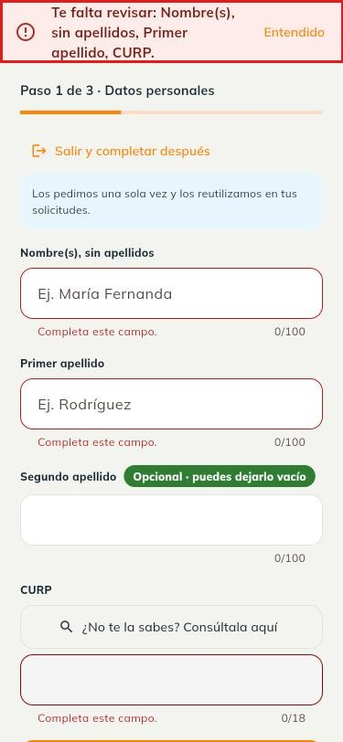 |
| 14 | **«¿No te la sabes? Consúltala aquí»** sube arriba del campo CURP como botón (antes era un enlace chico debajo, junto al contador). | 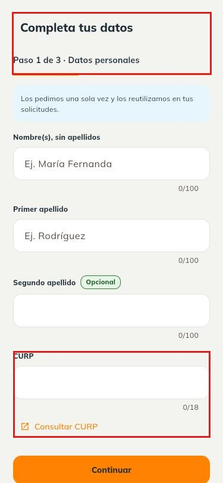 | 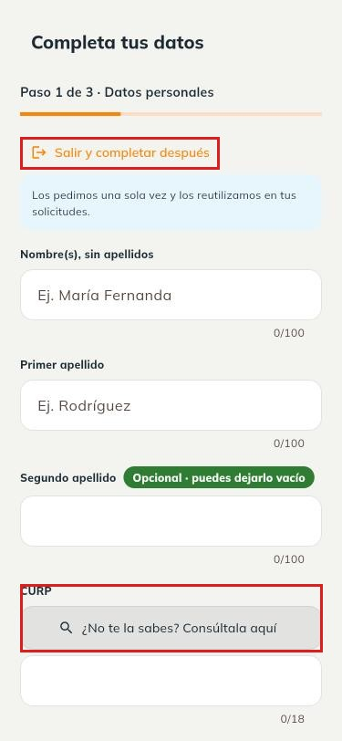 |
| 15 | **«Salir y completar después»** en «Completa tus datos», con confirmación: la cuenta ya quedó creada y los datos se piden antes de la primera solicitud. |  |  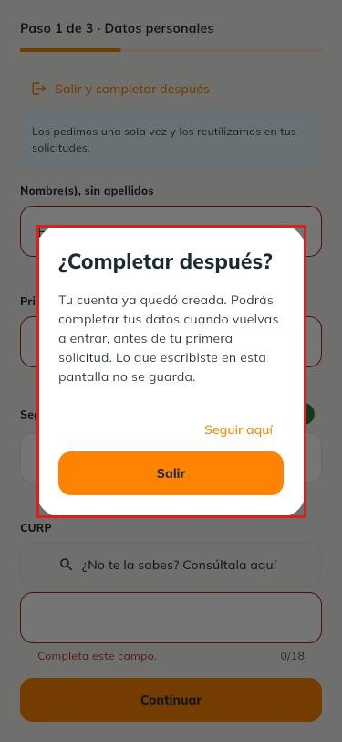 |
| 16 | **Inicio:** «Mis peticiones» pasa a título grande y el saludo «Hola, María» se hace más chico. | 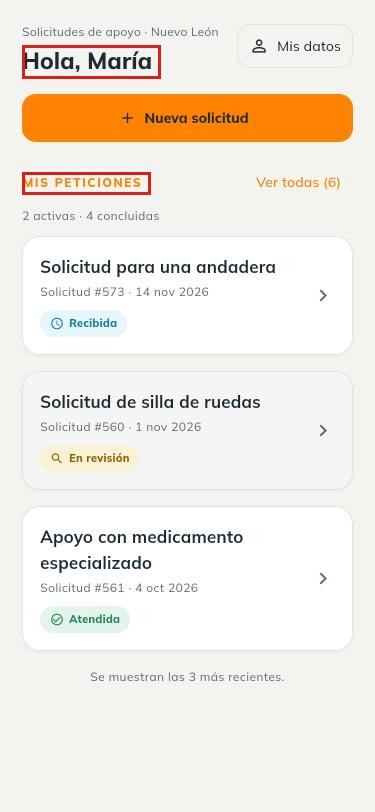 | 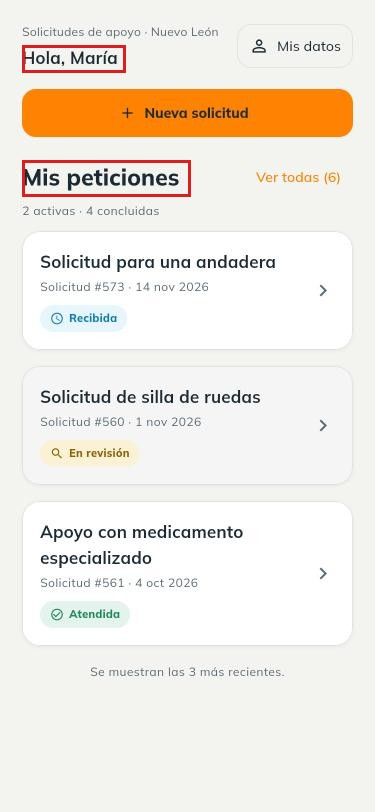 |
| 17 | **Parentesco con el catálogo del Ejecutivo** (Cat_Parentescos): Padre, Madre, Abuelo o abuela, Tío o tía, Sobrino o sobrina, Primo o prima, Hijo o hija, Esposo o esposa, Amigo o amiga, Vecino o vecina, Conocido o conocida y Otro; se muestran como «Mi padre», «Mi madre»… Sigue sin ser campo libre (solo «Otro» abre un campo). | 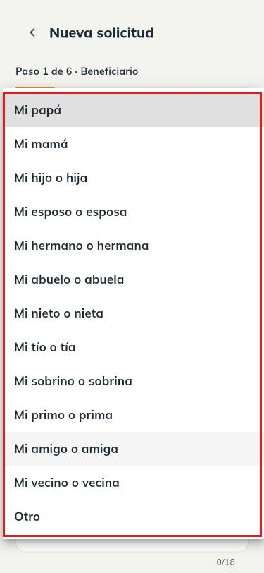 | 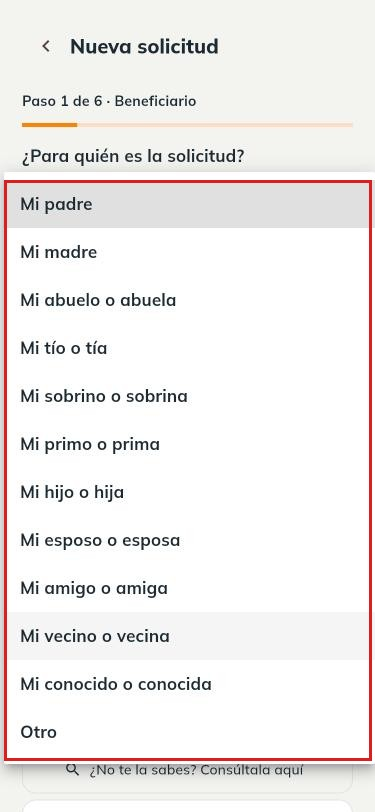 |
| 18 | **Seguridad social:** la pregunta pasa a «¿En dónde tiene servicio médico el beneficiario?» con la ayuda «Ej. IMSS o ISSSTE. No es quien dará el apoyo.» **Opcional** ahora es una etiqueta verde sólida con letra blanca, y la unidad médica dice «Si no la sabes, déjalo en blanco.» | 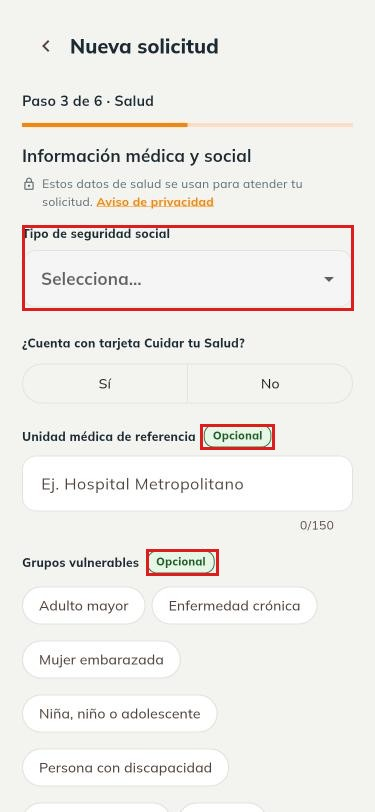 | 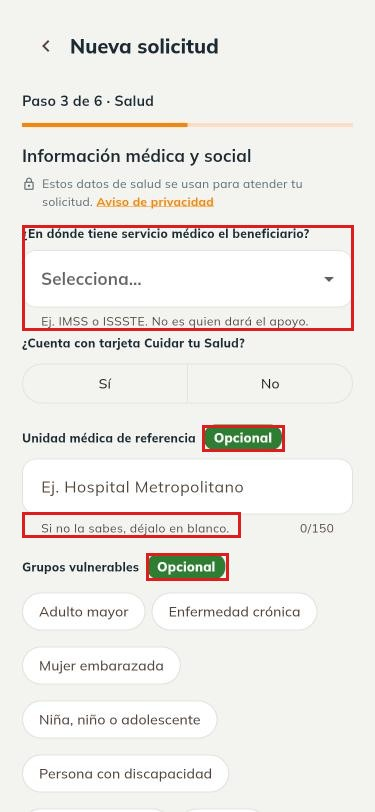 |
| 19 | **Recorrido guiado de primera vez** en Inicio: oscurece la pantalla, resalta un botón a la vez y explica qué hace (Nueva solicitud → Mis peticiones → Mis datos), con «Siguiente» y «Saltar». Aparece una sola vez por dispositivo. Está hecho como componente reutilizable para agregarlo después al Ejecutivo. | — | 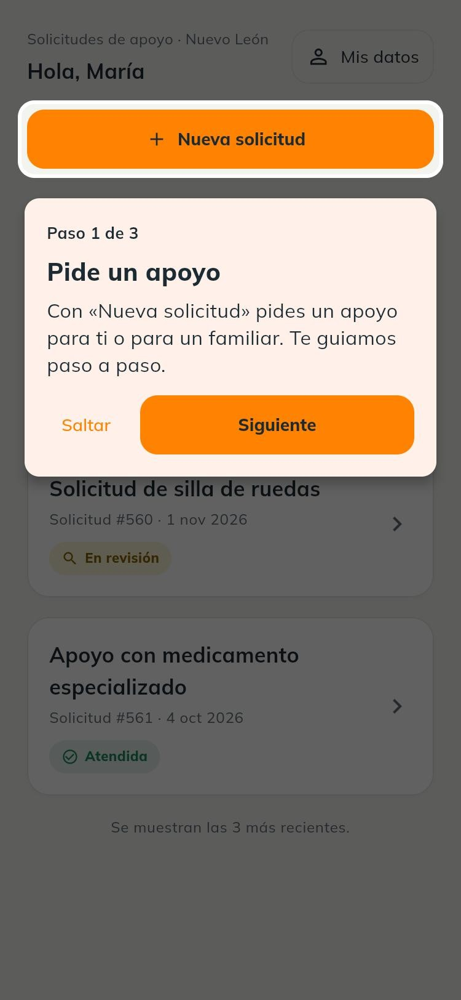 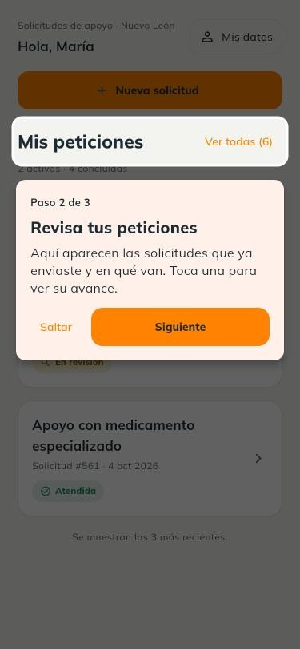 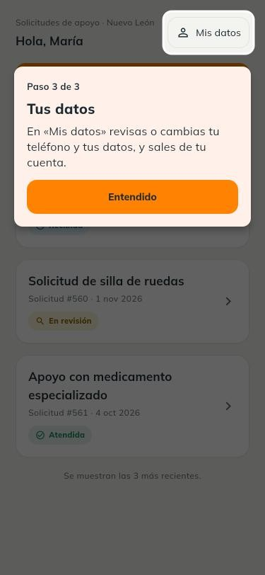 |
| 20 | El ejemplo del celular dice **«Ej. 81 1234 5678»** (en completar datos, Mis datos y la revisión de la solicitud), para que no parezca un número ya capturado. | — | — |

Nota: en las capturas 13 y 15 la etiqueta aún decía «Opcional · puedes dejarlo vacío»; se acortó a «Opcional» porque en campos de media columna se partía en dos renglones (versión final en la captura 18).
